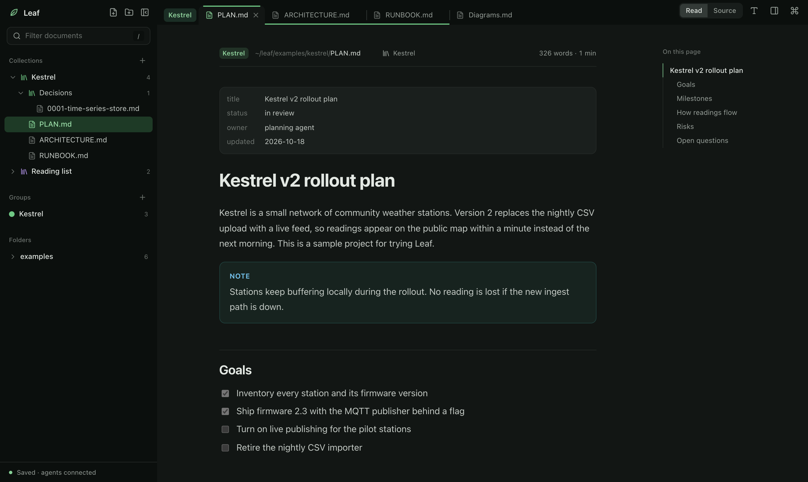
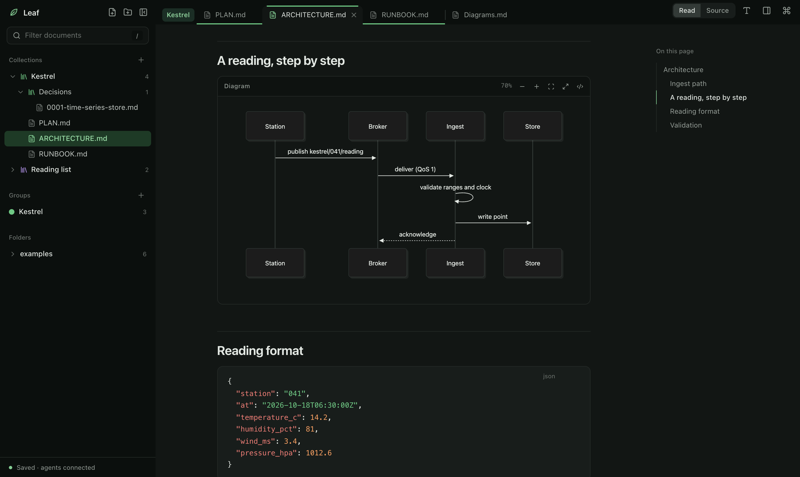

<p align="center">
  
</p>

<h1 align="center">Leaf</h1>

<p align="center">
  <strong>One calm place to read everything your agents write.</strong><br>
  A local reader for the plans, designs, and architecture notes scattered across your projects,<br>
  driven equally well by you and by your AI agents.
</p>

<p align="center">
  
  
  
  
  
  
  <a href="LICENSE"></a>
</p>

<p align="center">
  
</p>

## Why Leaf

Agents produce a lot of Markdown: plans, designs, runbooks, decision records. It ends up spread across repositories,
scratch folders, and shared boards. Leaf gathers it into one persistent reading workspace in your browser:

- **Collections** link documents from anywhere into logical projects. Nothing moves on disk.
- **Tab groups** keep a project's open documents together, and can be closed and reopened as one.
- **Every action is a command.** Anything you can click, an agent can do with `leaf …`, so "open that in Leaf" just works.
- **Live reload.** When an agent rewrites a document you are reading, it updates in place and keeps your position.

Leaf is a reader. It never edits, moves, or deletes your files.

## Features

<table>
<tr>
<td width="50%" valign="top">

**Reading**
- GitHub-flavoured Markdown with callouts, task lists, and tables
- Mermaid diagrams, themed and isolated, with zoom, fit, and source
- Syntax highlighting with one-click copy
- YAML front matter shown as a properties block
- Outline that follows your reading position
- Light, dark, or system theme; sans or serif; adjustable size and line length

</td>
<td width="50%" valign="top">

**Organising**
- Nested collections that reference files anywhere, including Aboard boards
- Chrome-style tab groups with colours, collapse, close, and reopen
- Drag documents between folders, collections, groups, and tabs
- ⌘K palette for documents, tabs, collections, and commands
- Path entry that completes from disk, so big repositories stay usable
- One saved workspace shared by every browser window

</td>
</tr>
</table>

<p align="center">
  
</p>

## Quick start

Requires macOS or Linux, Python 3.10 or newer, and a modern browser. Building the interface needs Node.js and npm;
running a built installation needs only Python.

```sh
git clone https://github.com/leonidas1712/leaf.git ~/leaf
cd ~/leaf
python3 install.py            # builds the web UI and installs the `leaf` command
export PATH="$HOME/.local/bin:$PATH"

leaf ui                       # start Leaf and open the browser
leaf open examples            # add the bundled examples to the sidebar
```

The reader lives at <http://127.0.0.1:18764>. The service keeps running after you close the terminal; after a reboot,
run `leaf ui` again. Use `python3 install.py --skill` to also install the agent skill for Codex.

## Working with agents

Tell an agent to "open the plan in Leaf" and it runs the same commands you would:

```sh
leaf open ~/projects/atlas/PLAN.md            # open a document in a new tab
leaf open ~/projects/atlas/docs               # add a folder to the sidebar
leaf collection new Atlas --color blue --paths ~/projects/atlas/PLAN.md
leaf collection add Atlas aboard://atlas/notes/design.md
leaf group new Review --paths ~/a.md ~/b.md   # group open tabs
leaf heading "Rollback"                       # scroll the live reader to a heading
leaf state --json                             # everything the reader shows, as JSON
```

Every command accepts `--json`. Results distinguish **saved** (written to the workspace) from **applied** (a
connected browser has rendered it), so an agent can tell when you can actually see the change. Run `leaf guide` for
the full agent instructions and see [AGENT-CONTROL.md](AGENT-CONTROL.md) and [API.md](API.md) for the contracts.

## Organising documents

| | What it is | Use it for |
| --- | --- | --- |
| **Folders** | Real directories on disk, mirrored read-only | Browsing a project you want in full |
| **Collections** | Leaf-only, nestable lists of links to documents anywhere | A logical project that spans repos, folders, and boards |
| **Groups** | Sets of open tabs, like Chrome tab groups | The documents you are working with right now |

Hover a collection and choose **Open** to open its documents as a group. Drag a document onto a collection or group
to add it. Deleting a collection or group never touches the files.

```sh
leaf collection new Plans --parent Atlas
leaf collection open Atlas                    # open Atlas and its sub-collections as a tab group
leaf group close Review                       # put a group's tabs away
leaf group open Review                        # restore them, positions included
```

## Keyboard

| Key | Action | Key | Action |
| --- | --- | --- | --- |
| <kbd>⌘</kbd> <kbd>K</kbd> | Command palette | <kbd>[</kbd> <kbd>]</kbd> | Previous or next tab |
| <kbd>⌘</kbd> <kbd>\\</kbd> | Toggle sidebar | <kbd>1</kbd>–<kbd>9</kbd> | Jump to a tab |
| <kbd>⌘</kbd> <kbd>.</kbd> | Toggle outline | <kbd>x</kbd> | Close tab |
| <kbd>/</kbd> | Filter the sidebar | <kbd>s</kbd> | Toggle Markdown source |
| <kbd>o</kbd> | Open a document by path | <kbd>t</kbd> | Toggle light and dark |

## Aboard artifacts

With the Aboard CLI installed and connected, open a board file directly:

```sh
leaf open aboard://leaf/notes/ui-plan.md --server aboard
leaf open aboard://leaf/notes/ui-plan.md@v1 --server aboard
leaf refresh --aboard
```

Leaf caches the download privately, shows the board and version above the document, and groups board files under the
board's name unless you pass `--group`. Unpinned files update on explicit refresh; pinned `@vN` files stay fixed.

## Your saved workspace

Tabs, their order and reading positions, groups, collections, sidebar folders, recent paths, and reader settings are
saved automatically and survive restarts. All connected browser windows show the same workspace, and a stale window
cannot overwrite a newer change. If a saved file goes missing, its tab stays; restore the file and run `leaf refresh`.

| Item | Location |
| --- | --- |
| Command | `~/.local/bin/leaf` |
| Saved workspace | `~/.local/state/leaf-reader/workspace.json` |
| Private service connection | `~/.local/state/leaf-reader/connection.json` |
| Service log | `~/.local/state/leaf-reader/server.log` |

## Privacy and security

- The service binds only to `127.0.0.1`, requires a private token, and rejects foreign origins. Do not expose it through a tunnel.
- Leaf reads only files you open and never uploads them. Remote images stay unloaded; web links open only when selected.
- Markdown is sanitised, documents cannot run scripts, and Mermaid diagrams render as isolated images.
- Folder scans skip hidden entries, symlinks, and dependency folders, with a 10 MB limit per file and 20,000 files per folder.

## Development

```text
leaf.py        CLI              workspace.py   durable state and revisions
server.py      local service    groups.py      tab groups and collections
web/           React + Vite + TypeScript + Tailwind + shadcn/ui interface
```

```sh
python3 -m unittest discover -p 'test_*.py' -v
npm --prefix web run build
leaf restart                                  # pick up Python changes; refresh the browser for UI changes
```

For an isolated instance that leaves your real workspace alone, run
`LEAF_STATE_DIR=/tmp/leaf-dev python3 server.py --port 18765`.

The installer points the `leaf` command at this checkout, so keep it in place. After moving it or changing Python
installations, run `python3 install.py` again. To uninstall, run `leaf stop` and remove `~/.local/bin/leaf`; your
documents and saved workspace are untouched.
