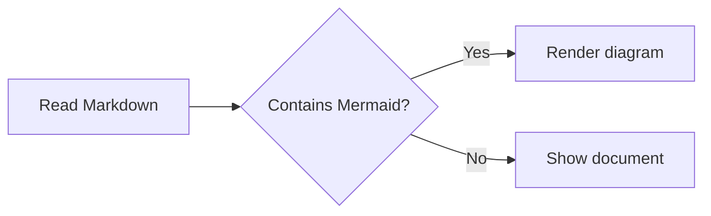
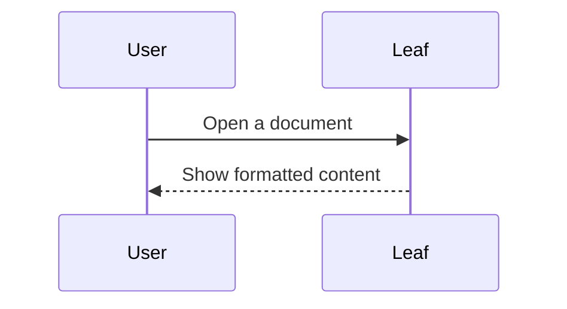

# Diagram examples

## Flowchart



## Sequence diagram



## Invalid source stays readable

This intentional syntax error demonstrates the fallback:

```mermaid
flowchart TD
  A[Unclosed node
```
