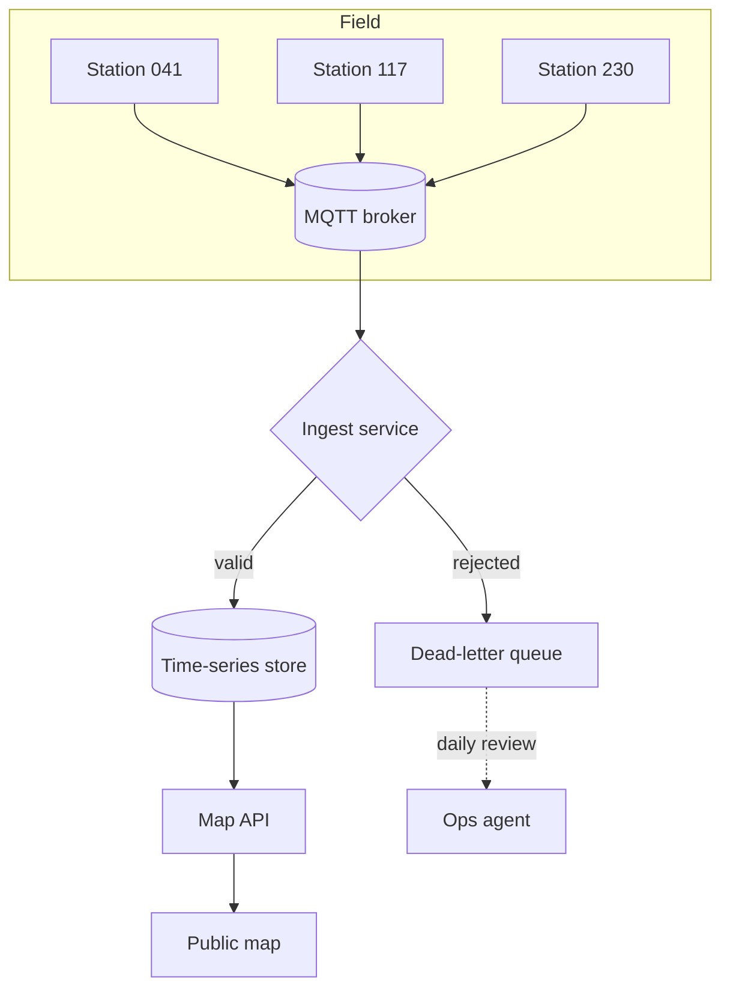
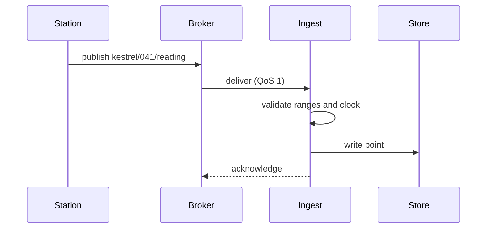

# Architecture

Kestrel v2 has three moving parts: stations that publish readings, an ingest service that checks them, and a
public map that reads the results. Everything outside the stations runs on one small server.

## Ingest path



Each reading carries the station ID, a timestamp, and up to eight sensor values. The ingest service rejects a
reading when its timestamp is more than five minutes ahead, when a value is outside the sensor's physical range,
or when the station is unknown.

## A reading, step by step



## Reading format

```json
{
  "station": "041",
  "at": "2026-10-18T06:30:00Z",
  "temperature_c": 14.2,
  "humidity_pct": 81,
  "wind_ms": 3.4,
  "pressure_hpa": 1012.6
}
```

## Validation

```python
def accept(reading, station, now):
    if reading["at"] > now + FIVE_MINUTES:
        return reject("clock ahead")
    for name, value in reading.items():
        low, high = station.ranges.get(name, (None, None))
        if low is not None and not low <= value <= high:
            return reject(f"{name} out of range")
    return store(reading)
```

| Sensor | Range | Unit |
| --- | --- | --- |
| Temperature | −40 to 60 | °C |
| Humidity | 0 to 100 | % |
| Wind | 0 to 75 | m/s |
| Pressure | 870 to 1085 | hPa |

> [!TIP]
> The dead-letter queue is the first place to look when a station goes quiet on the map.
