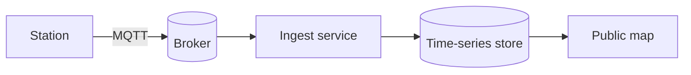

# Kestrel v2 rollout plan

Kestrel is a small network of community weather stations. Version 2 replaces the nightly CSV upload with a live
feed, so readings appear on the public map within a minute instead of the next morning. This is a sample project
for trying Leaf.

> [!NOTE]
> Stations keep buffering locally during the rollout. No reading is lost if the new ingest path is down.

## Goals

- [x] Inventory every station and its firmware version
- [x] Ship firmware 2.3 with the MQTT publisher behind a flag
- [ ] Turn on live publishing for the pilot stations
- [ ] Retire the nightly CSV importer

## Milestones

| Milestone | Stations | Target | Owner |
| --- | ---: | --- | --- |
| Pilot | 12 | 4 November | field team |
| Region north | 86 | 18 November | field team |
| Everyone else | 241 | 2 December | ops agent |

## How readings flow

See [the architecture notes](ARCHITECTURE.md#ingest-path) for the full picture. In short, a station publishes a
reading every 30 seconds, the ingest service validates it, and the map reads from the time-series store.

## Risks

> [!WARNING]
> Firmware 2.1 stations cannot publish over MQTT. They stay on the CSV path until a technician visits.

1. Cellular data caps on remote stations. Readings are batched to stay under 40 MB per month.
2. Clock drift. The ingest service rejects readings more than 5 minutes in the future.
3. Map load at the top of the hour. The map caches tiles for 60 seconds.

## Open questions

Who owns the broker certificates after the pilot? Do we keep the CSV archive once v2 is everywhere?
